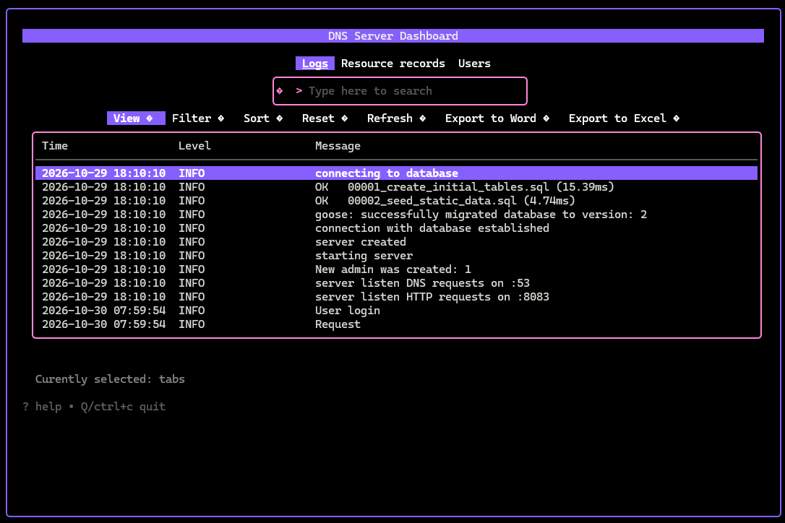
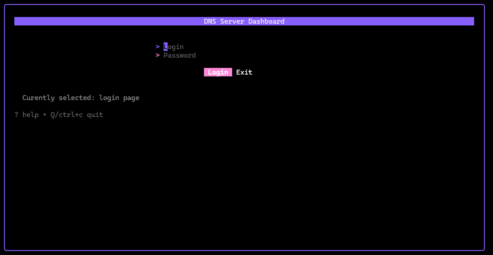
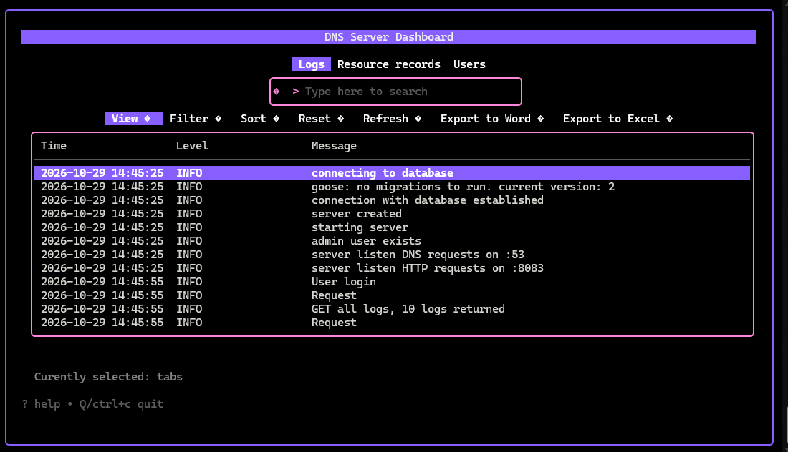
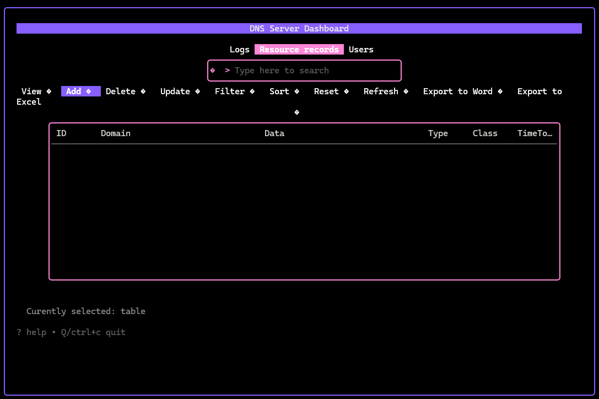

[](https://go.dev/)
[](https://www.postgresql.org/)
[](https://www.docker.com/)
[](https://sqlc.dev/)
[](https://prometheus.io/)
[](LICENSE)

# DNS Server

<br>
<div style="display: flex; justify-content: center; align-items: center;">

</div>
<br>

A Go DNS server that answers queries from PostgreSQL-stored records, exposes a protobuf HTTP CRUD API, and includes CLI + TUI administration tools.

## Key Features

- DNS server (UDP + TCP) backed by PostgreSQL
- HTTP API with protobuf serialization for records and users
- JWT cookie authentication + role-based access (`admin` / `user`)
- Prometheus metrics on `/metrics`
- Structured JSON logging + real-time WebSocket log streaming
- CLI for record management and a Bubble Tea TUI dashboard

## Built With

- Go 1.25+
- chi, gorilla/websocket, golang-jwt/jwt
- pgx, goose, sqlc
- Prometheus client
- Bubble Tea (TUI)

## Getting Started

### Prerequisites

- Go 1.25+
- PostgreSQL 15+
- Docker & Docker Compose (optional)

### Quick Start with Docker Compose

```bash
git clone https://github.com/prionis/dns-server
cd dns-server
docker compose up
```

- DNS: `localhost:53` (UDP/TCP)
- HTTP API: `localhost:8083`

> Port 53 must be free.

### Local Build

```bash
go build -o dns-server .
```

### Configuration

Create `dns-server.env` and `postgres.env` (or use the provided examples):

dns-server.env

```
JWT_SECRET=your-secret-key
HTTP_PORT=8083
DNS_PORT=53
HTTPS=false
HTTP_HOST=localhost # if you want to run UI from different address
```

postgres.env

```
POSTGRES_USER=dnsuser
POSTGRES_PASSWORD=dnsuserpass
POSTGRES_DB=dnsdb
POSTGRES_ADDR=localhost   # or "postgres" inside Docker Compose
```

# Usage

The same binary acts as server or client.

### Start the server

```bash
./dns-server -server
```

Migrations run automatically. An initial admin user (`admin` / `admin`) is created if none exists.

### Visual user interface

```
./dns-server -tui          # requires running server
```

#### Login



#### Navigation



#### Add



### CLI

```bash
./dns-server -add "example.com. 3600 IN A 192.168.1.1"
./dns-server -del 42
./dns-server -records
./dns-server -logs
```

### Querying with dig

After starting the server and adding records, you can query it with `dig`:

```bash
# dig @127.0.0.1 domain.com
; <<>> DiG 9.20.30 <<>> @127.0.0.1 domain.com
; (1 server found)
;; global options: +cmd
;; Got answer:
;; ->>HEADER<<- opcode: QUERY, status: NOERROR, id: 33146
;; flags: qr; QUERY: 1, ANSWER: 1, AUTHORITY: 0, ADDITIONAL: 0
;; QUESTION SECTION:
;domain.com.                    IN      A
;; ANSWER SECTION:
domain.com.             10      IN      A       127.0.0.1
;; Query time: 0 msec
;; SERVER: 127.0.0.1#53(127.0.0.1) (UDP)
;; WHEN: Fri Oct 30 08:08:48 UTC 2026
;; MSG SIZE  rcvd: 44
```

## HTTP API

Most endpoints require a JWT cookie obtained from `/auth/login`.

- **Auth**: `POST /auth/login`, `POST /auth/register` (admin)
- **Users** (admin): `GET/DELETE/PATCH /api/users…`
- **Resource Records**: full CRUD under `/api/rrs`
- **Logs**: `GET /api/logs/all`, WebSocket at `/api/logs/ws`
- **Metrics**: `GET /metrics`

Protobuf definitions live in `crud.proto`.
